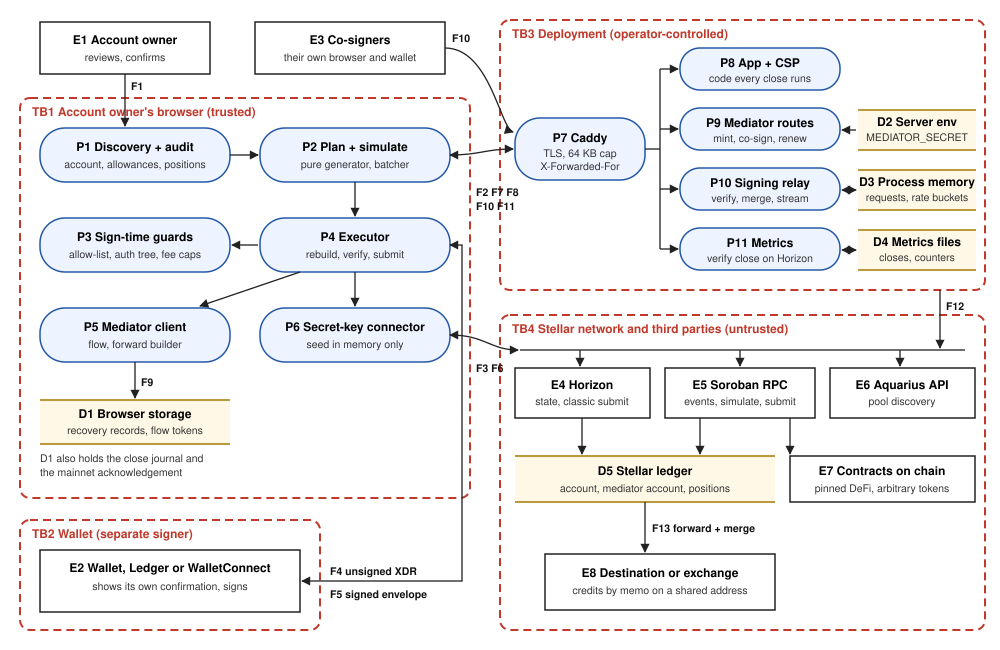

# Account Demolisher: STRIDE Threat Model

Prepared for the Soroban Security Audit Bank intake on 13 October 2026 and last updated on
21 October 2026. It describes release `v1.0.2` (commit `a55d98b`) of
<https://github.com/bytemaster333/account-demolisher>, the version the live deployment runs, including
the Lumeus history index added on 19 October (Tamper.9, DoS.8). It follows the SDF STRIDE template
(<https://developers.stellar.org/docs/build/security-docs/threat-modeling>).
Live deployment: <https://demolisher.app>. Documentation: <https://docs.demolisher.app>.

## 1. What are we working on?

Account Demolisher closes a Stellar account cleanly and sends everything in it to one destination
(another wallet or an exchange). In one reviewed flow it:

- cancels DEX offers and withdraws classic AMM shares;
- unwinds Soroban DeFi positions (Blend, Aquarius, Soroswap) and drains SEP-41 tokens;
- revokes token allowances and claims selected claimable balances;
- sells credit balances for XLM within a price cap;
- removes trustlines, data entries and extra signers;
- runs `ACCOUNT_MERGE`.

Most exchanges do not credit a merge. So an exchange close first merges into a short-lived
**mediator** account, then forwards a payment that carries the memo, plus a merge, to the exchange.
A standalone page lists and revokes token allowances without closing anything. A signing relay
collects co-signer signatures when the account is shared (multisig).

**What is in the codebase.** The project deploys no smart contract of its own. It is a Next.js 16
TypeScript application. The code that holds value at risk is:

- **Browser (client) code**, about 21,000 lines in the library layer:
  - account audit and position discovery;
  - the pure plan generator and the classic batcher;
  - Soroban transaction building and simulation;
  - sign-time guards: allow-list, authorization tree, fee caps;
  - the executor and its recovery;
  - the wallet abstraction;
  - the mediator client and forward builder;
  - partial-XDR multisig merging.
- **Server code**, about 3,700 lines:
  - the mediator routes (mint, co-sign, renew), which hold the HMAC master `MEDIATOR_SECRET`;
  - the in-memory signing relay;
  - the rate limiter;
  - the metrics store and its on-chain close verification.
- **Contracts it calls**: third-party, and not in scope for a re-audit. These are pinned entry points
  of Blend, Aquarius and Soroswap, plus arbitrary SEP-41 token contracts found on the user's
  account.

### Happy path of a close

The threat tables refer to these step numbers.

1. **Load.** The browser loads the app over HTTPS from the deployment (a Caddy TLS proxy in front of
   `next start`), under a strict Content-Security-Policy.
2. **Connect.** The user connects a wallet through Stellar Wallets Kit (Freighter, Ledger, xBull,
   Albedo, Rabet, LOBSTR, Hana, WalletConnect). The other option is to paste a secret key, which
   stays in browser memory.
3. **Discover.** The browser:
   - audits the account on Horizon;
   - scans allowances through Soroban RPC events and, when a key is configured, through the
     account's whole history on Lumeus, a hosted history index run by a partner;
   - reads DeFi positions directly from the protocol contracts;
   - asks the Aquarius API for pools;
   - asks Lumeus for the account's held contract tokens and Aquarius router deposits.
4. **Plan and preview.** A pure generator turns that state into a dependency-ordered plan tree.
   - Every Soroban step is built and simulated.
   - The sign-time checks run early, so an unsafe step is refused before the user confirms.
   - Hard stops: `AUTH_IMMUTABLE`, an account that sponsors others, and an open position that cannot
     be read.
5. **Confirm.** The user types the last four characters of the destination and waits out a timed
   delay. This step also has the high-value acknowledgement, scam-token warnings, and memo
   enforcement for exchange destinations.
6. **Execute.** For each step the browser:
   1. re-audits the account or re-simulates the step, and rebuilds the transaction;
   2. checks its target, authorization tree and fee;
   3. asks the wallet to sign;
   4. verifies the returned envelope's hash and signature;
   5. submits it to Horizon or Soroban RPC.
7. **Mediator (exchange close only).**
   1. Right before the merge batch, the browser mints a flow (`GET /api/mediator/sign`) bound to the
      destination, network and memo.
   2. It stores a recovery record in browser storage.
   3. It funds the mediator and merges into it.
   4. It builds the two-operation forward and asks the server to co-sign it
      (`POST /api/mediator/sign`).

   A flow token can be renewed while the mediator account exists (`POST /api/mediator/reissue`).

8. **Shared account (multisig only).**
   1. The initiator publishes a transaction signed by one signer to the relay (`POST /api/plan`).
   2. Each co-signer opens `/sign`, fetches the transaction, signs it in their own wallet and posts
      the signature.
   3. The relay verifies and merges the signatures and streams the state.
   4. The initiator submits once the threshold is met.
9. **Metrics.** The browser reports visits, funnel steps and the merge hash to
   `POST /api/metrics`. The server counts a close only after verifying it on Horizon. The operator
   reads the totals with a bearer token.

### Dataflow diagram

Red dashed boxes are trust boundaries. Rounded blue boxes are processes, white rectangles are
external entities, and the amber bars open at both ends are data stores.

| Flow | From, to                         | Data                                                                                                                      | Crosses    |
| ---- | -------------------------------- | ------------------------------------------------------------------------------------------------------------------------- | ---------- |
| F1   | E1 to P1..P4                     | destination, memo, per-balance choices, typed confirmation                                                                | none       |
| F2   | P8 via P7 to the browser         | all JavaScript the close runs, the CSP and security headers                                                               | TB3 to TB1 |
| F3   | P1 to E4, E5, E6, E7             | sends the account address; receives balances, offers, signers, positions, allowance events, pool lists and Lumeus history | TB1 to TB4 |
| F4   | P4 to E2                         | unsigned transaction XDR plus the network passphrase                                                                      | TB1 to TB2 |
| F5   | E2 to P4                         | signed envelope, checked by `verifySignedEnvelope`                                                                        | TB2 to TB1 |
| F6   | P4 to E4, E5                     | signed classic and Soroban transactions                                                                                   | TB1 to TB4 |
| F7   | P5 to P9                         | mint: sends destination, network and memo; receives the flow token and the mediator public key                            | TB1 to TB3 |
| F8   | P5 to P9                         | co-sign: the forward envelope and flow token; renew: the flow token                                                       | TB1 to TB3 |
| F9   | P5 to D1                         | recovery record: account, mediator, flow token, destination, memo, network                                                | none       |
| F10  | the browsers of E1 and E3 to P10 | partially signed envelope, added signatures, the server-sent state stream                                                 | TB1 to TB3 |
| F11  | browser to P11                   | visit and funnel counters, the merge transaction hash                                                                     | TB1 to TB3 |
| F12  | P9, P10, P11 to E4               | mediator existence, account signers and thresholds, merge transaction lookup                                              | TB3 to TB4 |
| F13  | D5 to E8                         | forward payment with the committed memo, then the merge of the mediator                                                   | TB4        |

### Assets, from most to least severe

1. The user's account and every balance in it. A close is irreversible.
2. The balance in transit through a mediator, between the merge into it and the forward out of it.
3. `MEDIATOR_SECRET`, from which every mediator key and every flow-token MAC is derived.
4. Signing keys:
   - the user's keys, which never leave the browser or the wallet;
   - the per-flow mediator keys, derived on demand and never stored.
5. The integrity of the compiled-in contract allow-list and of the plan. What is signed is what was
   reviewed, and no merge runs while a position is open.
6. The availability of the mediator routes while a forward is pending.

## 2. What can go wrong?

Each issue names the step (section 1) and the flow (diagram) it applies to.

### Spoofing

| ID      | Issue                                                                                                                                                                                                             |
| ------- | ----------------------------------------------------------------------------------------------------------------------------------------------------------------------------------------------------------------- |
| Spoof.1 | (Step 2, F5) A hostile wallet, extension or WalletConnect peer returns an envelope that is not the transaction the app built, or that is signed by a different key.                                               |
| Spoof.2 | (Step 7, F7) Script in the page (an XSS flaw or a malicious extension) calls the mint route itself and gets a flow bound to an attacker's destination and memo, impersonating the app.                            |
| Spoof.3 | (Step 8, F10) Someone who is not a signer of the account publishes a request to the relay, or posts a signature, to impersonate a co-signer.                                                                      |
| Spoof.4 | (Step 5, F1) A look-alike token poses as a valuable asset, so the user disposes of it on false assumptions. Examples: the symbol `USDC` or `XLM` from a non-canonical issuer, or a symbol with hidden characters. |
| Spoof.5 | (Step 7, F13) The destination is an exchange's shared address, and the memo decides whose account is credited. A wrong, missing or swapped memo credits someone else.                                             |
| Spoof.6 | (Step 9, F11) Anyone can post a fabricated close to inflate the public close count.                                                                                                                               |

### Tampering

| ID       | Issue                                                                                                                                                                                                                                        |
| -------- | -------------------------------------------------------------------------------------------------------------------------------------------------------------------------------------------------------------------------------------------- |
| Tamper.1 | (Step 7, F8) A tampered forward envelope does one or more of: pays the balance to one address and merges the reserve to another, changes the memo, adds operations, raises the fee, or wraps the forward in a fee bump.                      |
| Tamper.2 | (Steps 3-6, F3) A compromised or hostile Horizon or Soroban RPC returns wrong balances, stale state, or a manipulated simulation whose authorization tree contains extra calls.                                                              |
| Tamper.3 | (Step 6, F3) A hostile SEP-41 token contract on the user's account adds sub-invocations to the simulated authorization tree of a revoke or transfer, or writes large entries so the rent lands on the signer.                                |
| Tamper.4 | (Step 6) A manipulated market makes a conversion sell far below fair value.                                                                                                                                                                  |
| Tamper.5 | (Steps 4-6) Account state changes between review and execution (a new offer, a new trustline, a co-signer editing signers), so the signed plan differs from the reviewed one. Or a merge runs while a position is still open and strands it. |
| Tamper.6 | (Step 1, F2) A compromised server or supply-chain package serves modified app code that changes the destination before the user signs.                                                                                                       |
| Tamper.7 | (Step 8, F10) A co-signer posts a signature for a different transaction, or submits a bloated envelope.                                                                                                                                      |
| Tamper.8 | (Step 1, F2) A network attacker in the middle injects script.                                                                                                                                                                                |
| Tamper.9 | (Step 3, F3) A compromised or wrong Lumeus answer adds fabricated approvals, tokens or pools, or leaves real ones out, so the plan revokes or sweeps the wrong things or misses a live one.                                                  |

### Repudiation

| ID          | Issue                                                                                                                                                    |
| ----------- | -------------------------------------------------------------------------------------------------------------------------------------------------------- |
| Repudiate.1 | (Step 7) A user disputes, with an exchange or the operator, that a forward was sent, or claims it went elsewhere. Or the operator denies co-signing one. |
| Repudiate.2 | (Step 8) A co-signer claims they never approved the shared close.                                                                                        |
| Repudiate.3 | (Step 5) A user claims they did not intend to close, or did not see a warning, for example the price-cap refusal or the high-value gate.                 |

### Information disclosure

| ID     | Issue                                                                                                                                                            |
| ------ | ---------------------------------------------------------------------------------------------------------------------------------------------------------------- |
| Info.1 | (Step 2) The pasted secret key leaks through the server, logs, storage, analytics or a crash report.                                                             |
| Info.2 | (Step 7, F9) A flow token stored in browser storage, or written to a log, is read by another party and reused.                                                   |
| Info.3 | (Step 7) A server error message or log line prints `MEDIATOR_SECRET`.                                                                                            |
| Info.4 | (Steps 3 and 9, F3, F11) Third-party hosts (RPC, the Aquarius API, Lumeus, WalletConnect) and the metrics endpoint learn which address is being closed and when. |
| Info.5 | (Step 8, F10) The relay exposes a pending shared close (account, signers, transaction) to anyone who learns its id.                                              |
| Info.6 | (Step 2) A pasted secret key stays readable in the page's memory after the close, for script that runs in the page later.                                        |

### Denial of service

| ID    | Issue                                                                                                                                                        |
| ----- | ------------------------------------------------------------------------------------------------------------------------------------------------------------ |
| DoS.1 | (F7, F8, F10, F11) Request floods or oversized bodies exhaust the server.                                                                                    |
| DoS.2 | (Step 8) An attacker fills the relay's capacity, so real shared closes cannot be published.                                                                  |
| DoS.3 | (Step 7) The mediator routes are unavailable (outage, restart, rate limit) after the account has merged into the mediator, stranding the balance in transit. |
| DoS.4 | (Steps 3-6) A Horizon or RPC outage, or a fee surge, mid-close leaves the account half dismantled.                                                           |
| DoS.5 | (Step 6) A hostile token makes its own transfer or revoke cost so much in fees that the close cannot proceed, or drains XLM through fees.                    |
| DoS.6 | (Steps 4-6) A plan strands the account: a merge before every subentry is gone, a step that can never succeed, or a cycle in the plan.                        |
| DoS.7 | (Step 8) Several app instances behind a load balancer do not share signing requests or rate limits, so a co-signer misses the request and limits multiply.   |
| DoS.8 | (Step 3, F3) The Lumeus publishable key is in the page, so anyone can copy it and spend its rate limit, or Lumeus is down, and the history read fails.       |

### Elevation of privilege

| ID          | Issue                                                                                                                                                                                    |
| ----------- | ---------------------------------------------------------------------------------------------------------------------------------------------------------------------------------------- |
| Elevation.1 | (Step 6, F3) A malicious position or token gets an arbitrary contract call into something the user signs: a call outside the protocol entry points, contract creation, or a wasm upload. |
| Elevation.2 | (Step 7) A holder of a valid flow token renews it for different terms, or uses it to co-sign anything other than the committed forward.                                                  |
| Elevation.3 | (Step 7) Whoever holds `MEDIATOR_SECRET` (the operator, or an attacker on the server) derives every mediator key and can move any balance currently in a mediator.                       |
| Elevation.4 | (Step 8) A single signer of a shared account collects enough weight to close it without the other signers.                                                                               |
| Elevation.5 | (Step 9) A visitor reads the operator's metrics totals without the admin token.                                                                                                          |
| Elevation.6 | (all routes) A spoofed `X-Forwarded-For` header lets one client escape the per-client rate limits.                                                                                       |

## 3. What are we going to do about it?

Each treatment names the code that implements it. The status column means:

- **Done**: implemented and covered by tests in this repository.
- **Accepted**: a remaining risk, disclosed to users.

### Spoofing

| Issue   | Treatment                                                                                                                                                                                                                                                                                                                                                                                                                                                | Status          |
| ------- | -------------------------------------------------------------------------------------------------------------------------------------------------------------------------------------------------------------------------------------------------------------------------------------------------------------------------------------------------------------------------------------------------------------------------------------------------------- | --------------- |
| Spoof.1 | **S1R1** `verifySignedEnvelope` (`src/lib/wallet/signed-envelope.ts`) refuses a returned envelope whose hash differs from the transaction the app built, or that carries no valid signature from the connected key. Every connector uses it, including the secret-key one.                                                                                                                                                                               | Done            |
| Spoof.2 | **S2R1** A CSP with no third-party script origin and `frame-ancestors 'none'` (`src/lib/config/csp.ts`). **S2R2** The remaining risk is disclosed to users: `script-src` keeps `'unsafe-inline'`, because Next 16 hydration scripts are not nonce-stamped in this deployment, so injected inline script could mint its own flow.                                                                                                                         | Done / Accepted |
| Spoof.3 | **S3R1** The relay (`src/server/signing-relay.ts`) accepts a request only when it already carries a valid signature from one of the account's signers, as read from Horizon. It merges a new signature only if that signature verifies against one of those signers for the stored transaction hash. The request id is the transaction hash, so a co-signer can confirm what the link names.                                                             | Done            |
| Spoof.4 | **S4R1** Scam-token checks (`src/lib/safety/`): a symbol that collides with a canonical issuer, look-alike symbols within edit distance 2, non-alphanumeric or text-reordering characters, unrecognized contracts. **S4R2** A conversion more than 2% worse than a reference trade of 1/1000 of the balance is never sold without the user's per-token decision.                                                                                         | Done            |
| Spoof.5 | **S5R1** Memo enforcement: a destination in the exchange registry, or one that publishes the SEP-29 memo flag, needs a well-formed memo before the close starts. Exchange internal wallets are refused. **S5R2** The memo is bound into the flow-token MAC, and the validator checks the memo's type and bytes exactly. **S5R3** Typed confirmation of the destination's last four characters, with a timed delay and the memo shown on the same screen. | Done            |
| Spoof.6 | **S6R1** `verifyCloseTx` (`src/server/close-verify.ts`) counts a close only if Horizon shows a successful merge, shaped like this app's close and carrying the on-chain close marker. **S6R2** The marker is public, so anyone can copy it. Per-network daily caps (1,000 on mainnet, 200 on testnet) bound what copying adds, and the published count is described as merges that carried the marker.                                                   | Done / Accepted |

### Tampering

| Issue    | Treatment                                                                                                                                                                                                                                                                                                                                                                                                                                                                                                                                                                                                                                                                                                                                                                                                                                                                                                                                  | Status |
| -------- | ------------------------------------------------------------------------------------------------------------------------------------------------------------------------------------------------------------------------------------------------------------------------------------------------------------------------------------------------------------------------------------------------------------------------------------------------------------------------------------------------------------------------------------------------------------------------------------------------------------------------------------------------------------------------------------------------------------------------------------------------------------------------------------------------------------------------------------------------------------------------------------------------------------------------------------------ | ------ |
| Tamper.1 | **T1R1** `validateMediatorForwardEnvelope` (`src/lib/mediator/validator.ts`) accepts exactly one envelope shape: op0 a native payment and op1 an account merge, both from the mediator and both to the same committed destination; the committed memo; a fee of at most 2,000,000 stroops; time bounds as the only precondition, with `maxTime` within 3,600 s; no fee bump. Its 16 refusal codes are checked in order and each is tested. **T1R2** The browser checks that the co-signed transaction has the hash it built.                                                                                                                                                                                                                                                                                                                                                                                                               | Done   |
| Tamper.2 | **T2R1** Before every classic batch the executor re-audits the account and rebuilds the batch. Before every Soroban step it rebuilds and re-simulates. **T2R2** At sign time each Soroban transaction's call target, exact authorization tree and fee are checked (the guards in `src/lib/soroban/`), so a lying endpoint cannot widen what is signed. **T2R3** A merge guard refuses while any DeFi position is open or a protocol could not be read. **T2R4** A failed fee read fails the step instead of bidding the minimum.                                                                                                                                                                                                                                                                                                                                                                                                           | Done   |
| Tamper.3 | **T3R1** A revoke is held to exactly `approve(user, spender, 0, ledger)` and a transfer to exactly `transfer(user, destination, amount)`, with source-account credentials and no sub-invocations (`src/lib/soroban/revoke-guard.ts`, `src/lib/soroban/transfer-guard.ts`). **T3R2** Each class of step has a resource-fee cap and a bound on the bytes and entries it may write (`src/lib/soroban/fee-cap.ts`). Each cap is two to three times the largest legitimate case measured on testnet and mainnet. **T3R3** A token that reports more than 20 spenders is cut off and flagged.                                                                                                                                                                                                                                                                                                                                                    | Done   |
| Tamper.4 | **T4R1** Minimum outputs carry the configured slippage (1% by default). **T4R2** A fresh quote worse than the reviewed one stops the close (`conversion_refused`) instead of selling. **T4R3** The 2% price-impact cap: a full-size trade compared with a reference trade.                                                                                                                                                                                                                                                                                                                                                                                                                                                                                                                                                                                                                                                                 | Done   |
| Tamper.5 | **T5R1** The account is rebuilt from fresh state before each phase, and a conversion whose fresh price is outside the tolerance is refused. **T5R2** Property-based fuzzing (`tests/unit/plan-fuzz.test.ts`, fast-check) runs the planner over randomized account states. It asserts that no plan strands the account, and it detects cycles. **T5R3** A shared close is checked against the live account's signers and thresholds before submit. Requests for one account share a sequence number, so at most one of them lands.                                                                                                                                                                                                                                                                                                                                                                                                          | Done   |
| Tamper.6 | **T6R1** Supply-chain controls: the committed lockfile is installed with `--frozen-lockfile`; `pnpm audit --prod --audit-level high` runs in CI; the base image is pinned by digest; GitHub Actions are pinned by commit SHA and checked by zizmor and actionlint. **T6R2** The release workflow builds an artifact with a signed SLSA build-provenance attestation. **T6R3** A host can run the attested artifact instead of building from source: `scripts/deploy-release.sh` verifies the artifact with `gh attestation verify` (signed by `release.yml` in this repository, from the tagged commit, on a GitHub-hosted runner), and `release/Dockerfile` refuses any file whose SHA-256 differs from the verified one. The reference deployment runs releases this way since 13 October 2026; it runs `v1.0.2` since 19 October 2026. **T6R4** The security docs tell users that every close trusts the operator to serve honest code. | Done   |
| Tamper.7 | **T7R1** A signature is merged only when the transaction hash matches the stored one and the signature verifies. Duplicates are detected by the signer key recovered from the signature, and the envelope stops collecting at the threshold (`src/lib/multisig/partial-xdr.ts`). **T7R2** The envelope is capped at 24,576 base64 characters and the request body at 32,768 bytes.                                                                                                                                                                                                                                                                                                                                                                                                                                                                                                                                                         | Done   |
| Tamper.8 | **T8R1** HTTPS is terminated at Caddy with Let's Encrypt. Production sends HSTS, `X-Frame-Options: DENY`, `nosniff` and `Referrer-Policy: no-referrer`. The CSP `connect-src` lists every host the browser may contact.                                                                                                                                                                                                                                                                                                                                                                                                                                                                                                                                                                                                                                                                                                                    | Done   |
| Tamper.9 | **T9R1** Lumeus only adds candidates. Every allowance is read again with `allowance()`, every token with `balance()` and every pool through the Aquarius router before the plan uses it (`src/lib/lumeus/client.ts`). **T9R2** The RPC scans still run and their results are unioned with Lumeus by the RPC event id, so a recent row Lumeus leaves out is still found. **T9R3** A Lumeus walk counts only when it reached the end of its range, and it closes an RPC scan's gap only when it covers the ledgers that scan reached (`mergePartnerEvents`).                                                                                                                                                                                                                                                                                                                                                                                 | Done   |

### Repudiation

| Issue       | Treatment                                                                                                                                                                                                                                                                                                                                                                                                                                                                                                                                                                                                                                                                                                                                                                                                                                       | Status |
| ----------- | ----------------------------------------------------------------------------------------------------------------------------------------------------------------------------------------------------------------------------------------------------------------------------------------------------------------------------------------------------------------------------------------------------------------------------------------------------------------------------------------------------------------------------------------------------------------------------------------------------------------------------------------------------------------------------------------------------------------------------------------------------------------------------------------------------------------------------------------------- | ------ |
| Repudiate.1 | **R1R1** Every forward and merge is a public, signed Stellar transaction. The user signs the merge into the mediator, and the mediator key signs the forward. Both are permanent ledger records, which settle any dispute about where the funds went. **R1R2** The browser keeps a recovery record per mediator. On later visits it reports whether the forward was delivered to the committed address or elsewhere. **R1R3** The server appends every forward it co-signs to `cosign.jsonl` (`src/server/cosign-log.ts`) and syncs it to disk before the signature leaves; when the write fails it answers `COSIGN_LOG_FAILED` and keeps the signature. Each line holds the hash, network, mediator, destination, memo, amount, fee and time bound, and never the flow token or its nonce, which with the master seed derive the mediator key. | Done   |
| Repudiate.2 | **R2R1** Each co-signer signs the exact transaction in their own wallet. The signature is on chain in the submitted envelope and identifies the signer key.                                                                                                                                                                                                                                                                                                                                                                                                                                                                                                                                                                                                                                                                                     | Done   |
| Repudiate.3 | **R3R1** The typed confirmation, the timed delay and the high-value acknowledgement are explicit acts, and the wallet shows its own confirmation for every transaction. **R3R2** On mainnet, the browser must acknowledge that the code has not had an independent audit before anything runs.                                                                                                                                                                                                                                                                                                                                                                                                                                                                                                                                                  | Done   |

### Information disclosure

| Issue  | Treatment                                                                                                                                                                                                                                                                                                                                                                                                                                                                                             | Status          |
| ------ | ----------------------------------------------------------------------------------------------------------------------------------------------------------------------------------------------------------------------------------------------------------------------------------------------------------------------------------------------------------------------------------------------------------------------------------------------------------------------------------------------------- | --------------- |
| Info.1 | **I1R1** `SecretKeyConnector` (`src/lib/wallet/secret-key.ts`) holds the seed in a private field for the connector's lifetime and rebuilds the keypair for each signature. The seed is never sent to the server, stored, or included in metrics, and no server route accepts a key.                                                                                                                                                                                                                   | Done            |
| Info.2 | **I2R1** A flow token only unlocks a forward to the committed destination, with the committed memo, on the committed network. Renewal keeps those terms, so a leaked token cannot redirect funds. **I2R2** A token lives 15 minutes. Old four-part tokens, which did not bind the memo, are refused.                                                                                                                                                                                                  | Done            |
| Info.3 | **I3R1** Mediator route errors go to the server log with any Stellar seed pattern redacted (`src/app/api/mediator/_shared/http.ts`), and clients get only an error code. The secret lives in an env file on the host readable only by its owner (mode 600).                                                                                                                                                                                                                                           | Done            |
| Info.4 | **I4R1** No third-party analytics. The metrics are first-party and carry no address, wallet id or amount. The merge hash is public on the ledger anyway. WalletConnect analytics and telemetry are off, and the remaining telemetry host is left out of `connect-src`. **I4R2** The security docs list for users the hosts that see the address: Horizon, RPC, the Aquarius API, Lumeus and the WalletConnect relay. The browser calls Lumeus directly, so the server still never learns the address. | Done / Accepted |
| Info.5 | **I5R1** A relay request holds only public data: a transaction envelope that will be on chain, and the signers read from Horizon. Its id is a 256-bit transaction hash. Requests live in memory and expire with the transaction, after at most 72 hours.                                                                                                                                                                                                                                              | Accepted        |
| Info.6 | **I6R1** JavaScript cannot erase memory, so `SecretKeyConnector` keeps the seed in a private field and drops it on disconnect, leaving it for the garbage collector. The CSP limits which scripts can load into the page (S2R1), and the connect screen keeps the pasted key under **Advanced**, for users with no wallet; a wallet keeps the key outside the page.                                                                                                                                   | Accepted        |

### Denial of service

| Issue | Treatment                                                                                                                                                                                                                                                                                                                                                                                                                                                                                                     | Status          |
| ----- | ------------------------------------------------------------------------------------------------------------------------------------------------------------------------------------------------------------------------------------------------------------------------------------------------------------------------------------------------------------------------------------------------------------------------------------------------------------------------------------------------------------- | --------------- |
| DoS.1 | **D1R1** Every route has a per-client token-bucket rate limit (`src/server/rate-limit.ts`): for example, mint allows 30 per 60 s per address and co-sign 10 per 60 s per flow. **D1R2** Request bodies are capped: 16,384 bytes on the mediator routes, 32,768 on the relay, 2,048 on metrics, and 64 KB at the proxy.                                                                                                                                                                                        | Done            |
| DoS.2 | **D2R1** The relay limits active requests per network (400 on mainnet, 100 on testnet) and per account (3). It allows at most 50 stream subscribers, 3 per client. Every request must be signed by a real signer of an existing account, which costs reserves on mainnet. Remaining risk: a funded attacker with many accounts can still fill the budget.                                                                                                                                                     | Done / Accepted |
| DoS.3 | **D3R1** Mediator keys are derived without stored state, from the master and the flow nonce, so a restarted or new server instance serves every pending flow. **D3R2** A recovery record is written before the funding batch is signed, and a close that cannot store one does not start. The forward can be resumed later, with token renewal, for as long as the mediator exists. **D3R3** When a mediator route is rate-limited or unreachable, the forward retries with backoff and honors `retry-after`. | Done            |
| DoS.4 | **D4R1** Soroban RPC has failover endpoints. The XState machine classifies each failure by type and recovers from it. Every phase rebuilds from fresh state, so a rerun continues from where the account actually is. **D4R2** Fee bids rise with network surge, up to a fixed ceiling.                                                                                                                                                                                                                       | Done            |
| DoS.5 | **D5R1** The same fee caps and write bounds as T3R2. A step over its cap is refused, with the fee spelled out, instead of signed.                                                                                                                                                                                                                                                                                                                                                                             | Done            |
| DoS.6 | **D6R1** Hard stops at audit time: `AUTH_IMMUTABLE` and sponsoring accounts. The close splits automatically past 100 operations, and for pool shares, isolated claims and conversions that share a market. The merge guard (T2R3) and the fuzzing in T5R2 also apply. The adversarial test corpus covers deleted issuers, non-compliant tokens, mid-flow changes and high subentry counts.                                                                                                                    | Done            |
| DoS.7 | **D7R1** The self-hosting guide says to run one instance, and why. The signing relay, the rate limiter, the metrics store and the co-sign log all keep their state or serialize their writes inside one process.                                                                                                                                                                                                                                                                                              | Accepted        |
| DoS.8 | **D8R1** The key is publishable: Lumeus accepts it only with an allowed `Origin`, only for read routes, and with a per-IP limit. A full or read key fails the build (`next.config.ts`). **D8R2** A failed Lumeus read leaves the RPC result as it was and is shown: the allowances page names the failure, and the close flow records it in its diagnostics.                                                                                                                                                  | Done            |

### Elevation of privilege

| Issue       | Treatment                                                                                                                                                                                                                                                                                                                                                                                                                                                                               | Status   |
| ----------- | --------------------------------------------------------------------------------------------------------------------------------------------------------------------------------------------------------------------------------------------------------------------------------------------------------------------------------------------------------------------------------------------------------------------------------------------------------------------------------------- | -------- |
| Elevation.1 | **E1R1** A per-network contract allow-list compiled into the app (`src/lib/config/contracts.ts`, `src/lib/stellar/allowlist.ts`), with each entry citing its upstream source. Only pinned entry points can be the root of a signed DeFi call, plus a router-resolved Aquarius pool for a gauge claim. Each call is held to its exact authorization tree. Contract creation and wasm upload are always refused. An automated test checks the enforcement.                                | Done     |
| Elevation.2 | **E2R1** The token MAC covers the version, nonce, expiry, network, destination and memo, and is compared in constant time. Renewal re-signs only the same nonce and terms, and only while the mediator account exists on chain.                                                                                                                                                                                                                                                         | Done     |
| Elevation.3 | **E3R1** The exposure is bounded in time: the merge into the mediator and the forward out of it run back to back. A direct close (no memo needed) never uses the mediator. **E3R2** The secret is only an HMAC master, never an account or a signing key. **E3R3** The security model tells users about this trust in the operator. Removing it would need an on-chain escrow or a pre-signed forward, which the exchange memo requirement makes hard. We want the auditor's view here. | Accepted |
| Elevation.4 | **E4R1** The relay and the submit path compute the weight needed from the account's live thresholds (`thresholdForClose`) and refuse to submit below it. The network also enforces thresholds on its own.                                                                                                                                                                                                                                                                               | Done     |
| Elevation.5 | **E5R1** `GET /api/metrics` answers 503 until `METRICS_ADMIN_TOKEN` is set to at least 16 characters, and 401 without the matching bearer token.                                                                                                                                                                                                                                                                                                                                        | Done     |
| Elevation.6 | **E6R1** The server refuses to start unless `TRUSTED_PROXY_HOPS` is a whole number of at least 1. Rate limits are keyed on the `X-Forwarded-For` entry that many hops from the right, and IPv6 clients by their /64. A deployment that cannot identify the client answers 500 instead of sharing one rate-limit bucket.                                                                                                                                                                 | Done     |

## 4. Did we do a good job?

**Has the dataflow diagram been referenced since it was created?** Yes. Its trust boundaries are the
same ones used by the published
[security model](https://docs.demolisher.app/docs/developers/security/model) and the architecture
reference, and the audit scope below follows them.

**Did the STRIDE model uncover new issues?** Yes. It found three issues that were not tracked
before:

- The server kept no record of what it co-signed (Repudiate.1). Fixed: R1R3 adds the co-sign log.
- The reference deployment built from source instead of running the attested release artifact
  (Tamper.6). Fixed: the reference deployment now runs the attested
  release (`v1.0.2` today) through the verified deploy path (T6R3).
- A funded attacker can still fill the relay's capacity (DoS.2). Accepted.

**Did the treatments address the issues?** For the browser-side and validator threats, yes: each one
is implemented and tested. The largest remaining risk is Elevation.3: an exchange close trusts the
operator with the balance between the merge and the forward. That risk is limited in time and
disclosed to users, not removed.

**Have additional issues been found after the threat model?** Before this model, an internal review
of the whole codebase recorded 261 issues. 259 were fixed and 2 were closed as not a bug. The
remediation summary is published at
<https://docs.demolisher.app/docs/developers/security/audit>. That was a self-review, not an
independent audit.

After the model, a CI run on live testnet found one more: when a stale quote let a sale be signed
and the network then failed it, the retry's stop message still said nothing was signed. The message
now counts what the close already signed (`signedSoFarNote` in `src/lib/orchestrator/executor.ts`).

### Requested audit focus

From the SCF tranche scope:

1. **Mediator-key handling and the merge-envelope validator:** `src/server/mediator-secret.ts`,
   `src/lib/mediator/`, `src/app/api/mediator/`.
2. **Plan-generation correctness:** `src/lib/plan/`, `src/lib/stellar/`, and the merge guard.
3. **Transaction and signature handling:**
   - the sign-time guards and fee caps in `src/lib/soroban/`;
   - `src/lib/wallet/` and `src/lib/multisig/`;
   - `src/server/signing-relay.ts`;
   - `src/lib/orchestrator/` and `src/lib/adapters/`.
4. **An SDK and dependency supply-chain review.**
